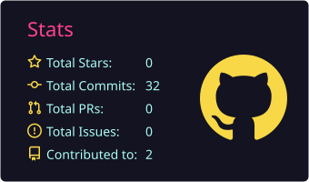
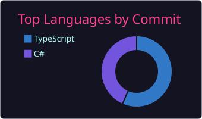

# Hi, I'm Abdelhadi 👋

Software engineer in the making, studying at USTHB in Algiers. I'm the kind of developer who can't leave a black box alone: I want to know what happens between the click and the database, and then build it better.

## About me

- 🎓 Master's student in Software Engineering 
- 🧠 I care about the "why" behind the code: architecture, trade-offs and how systems behave under pressure
- 🔬 Currently exploring distributed systems, from CAP theorem to CRDTs, and getting deeper into .NET
- 🌍 Based in Algeria, open to remote collaboration and international opportunities

## 🧰 Languages and Tools

  

## 📈 GitHub Stats

  
  

  

## 📫 Get in touch

- 📧 Abdeffou@gmail.com
- 💼 [LinkedIn](https://www.linkedin.com/in/abdelhadi-deffous-75189a229)
